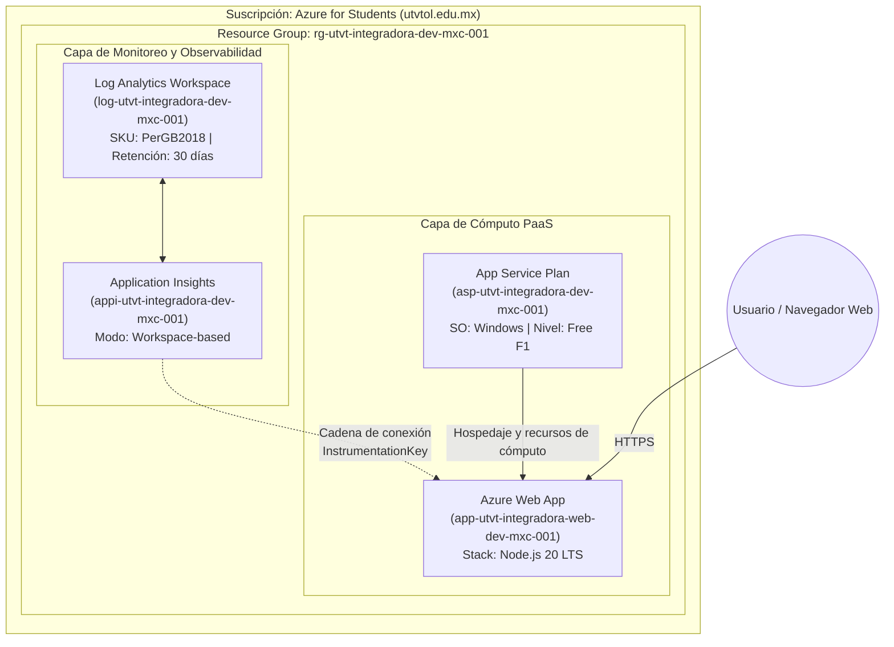

# Laboratorios de Azure — App Service & Observabilidad

[](https://azure.microsoft.com/)
[](https://nodejs.org/)
[](https://www.terraform.io/)
[](https://utvt.edomex.gob.mx/)
[](https://github.com/LudwinGarcia1)

Repositorio oficial de prácticas de **Computación en la Nube y Plataforma como Servicio (PaaS)** utilizando **Microsoft Azure App Service**, **Log Analytics** y **Application Insights**, correspondiente a la asignatura **Evaluación y Mejora para el Desarrollo de Software** en la **Universidad Tecnológica del Valle de Toluca (UTVT)**.

---

## 📌 Datos Institucionales

* **Institución:** Universidad Tecnológica del Valle de Toluca (UTVT)
* **Carrera:** Ingeniería en Desarrollo y Gestión de Software (IDGS)
* **Grupo:** IDGS-81
* **Asignatura:** Evaluación y Mejora para el Desarrollo de Software
* **Docente:** Mtro. Jorge Almeida Montiel
* **Alumno:** Ludwin García Gaytán
* **Matrícula:** `222310777`
* **Correo Institucional:** `al222310777@utvtol.edu.mx`
* **Práctica:** Asignación 12 — Azure Portal - App Service (Laboratorio 1)

---

## 📋 Matriz de Nomenclatura de Recursos (Componentes a crear)

Basado en el estándar oficial del laboratorio (`Componentes a crear.xlsx`):

| Tipo de Recurso Azure | Entorno Desarrollo (`dev`) | Entorno Pruebas (`qa`) | Entorno Producción (`prod`) |
| :--- | :--- | :--- | :--- |
| **Resource Group** | `rg-utvt-integradora-dev-mxc-001` | `rg-utvt-integradora-qa-mxc-001` | `rg-utvt-integradora-prod-mxc-001` |
| **App Service Plan** | `asp-utvt-integradora-dev-mxc-001` | `asp-utvt-integradora-qa-mxc-001` | `asp-utvt-integradora-prod-mxc-001` |
| **Web App** | `app-utvt-integradora-web-dev-mxc-001` | `app-utvt-integradora-web-qa-mxc-001` | `app-utvt-integradora-web-prod-mxc-001` |
| **Log Analytics Workspace** | `log-utvt-integradora-dev-mxc-001` | `log-utvt-integradora-qa-mxc-001` | `log-utvt-integradora-prod-mxc-001` |
| **Application Insights** | `appi-utvt-integradora-dev-mxc-001` | `appi-utvt-integradora-qa-mxc-001` | `appi-utvt-integradora-prod-mxc-001` |
| **Key Vault** *(Opcional)* | `kv-utvt-int-dev-mxc-001` | `kv-utvt-int-qa-mxc-001` | `kv-utvt-int-prod-mxc-001` |
| **PostgreSQL Flexible** *(Opcional)* | `pgsql-utvt-integradora-dev-mxc-001` | `pgsql-utvt-integradora-qa-mxc-001` | `pgsql-utvt-integradora-prod-mxc-001` |

---

## 🏗️ Arquitectura de la Solución (Lab 1)



---

## 🚀 Estructura del Repositorio

```text
azure-laboratories/
├── .gitignore
├── README.md
├── Lab 1/
│   ├── Componentes a crear.xlsx        # Matriz oficial de recursos para dev, qa y prod
│   ├── deploy-azure-resources.ps1      # Automatización en PowerShell con Azure CLI
│   ├── deploy-azure-resources.sh       # Automatización en Bash con Azure CLI
│   ├── main.tf                         # Infraestructura como Código (Terraform)
│   ├── variables.tf                    # Definición de variables de entrada
│   ├── outputs.tf                      # Salidas de infraestructura
│   ├── terraform.tfvars                # Valores de configuración
│   ├── arm-template.json               # Plantilla ARM nativa
│   └── bicep/
│       └── main.bicep                  # Plantilla Bicep modular
├── app/
│   ├── server.js                       # Servidor Express con SDK de Application Insights
│   ├── package.json                    # Dependencias Node.js
│   └── index.html                      # Interfaz visual con metadatos del estudiante
└── docs/
    ├── Reporte_Practica12_Azure_App_Service.docx  # Reporte formal de evidencias UTVT
    └── evidencias/                                # Capturas del Portal institucional y consola
        ├── 01_excel_matriz_componentes.png
        ├── portal_01_resource_group_overview.png
        ├── portal_02_log_analytics_overview.png
        ├── portal_03_app_insights_overview.png
        ├── portal_04_app_service_plan_overview.png
        ├── portal_05_web_app_overview.png
        ├── portal_06_group_insights_monitoring.png
        ├── term_01_az_group_and_account.png
        ├── term_02_az_resources_table.png
        └── term_03_az_webapp_details.png
```

---

## ⚙️ Métodos de Despliegue

### Opción A: Despliegue en Azure Portal (Paso a Paso)

1. **Grupo de Recursos:** Crear `rg-utvt-integradora-dev-mxc-001` en la región `Mexico Central`.
2. **Log Analytics:** Crear `log-utvt-integradora-dev-mxc-001` asignado al grupo anterior.
3. **Application Insights:** Crear `appi-utvt-integradora-dev-mxc-001` en modo basado en áreas de trabajo (*Workspace-based*), seleccionando el Log Analytics creado.
4. **App Service Plan:** Crear `asp-utvt-integradora-dev-mxc-001` para Windows en nivel `Gratis F1`.
5. **Web App:** Crear `app-utvt-integradora-web-dev-mxc-001` con runtime stack `Node 20 LTS`.
6. **Integración:** En la sección *Application Insights* de la Web App, habilitar la telemetría seleccionando el componente existente.

### Opción B: Despliegue Automatizado con Azure CLI

```powershell
cd "Lab 1"
.\deploy-azure-resources.ps1 -Location "mexicocentral"
```

### Opción C: Despliegue con Terraform

```bash
cd "Lab 1"
terraform init
terraform plan
terraform apply -auto-approve
```

---

## 📄 Entregables

1. **Código fuente:** Repositorio en GitHub [`LudwinGarcia1/azure-laboratories`](https://github.com/LudwinGarcia1/azure-laboratories).
2. **Reporte de evidencias:** Documento Word [`docs/Reporte_Practica12_Azure_App_Service.docx`](docs/Reporte_Practica12_Azure_App_Service.docx) y respaldo en la carpeta de documentos de Windows.
